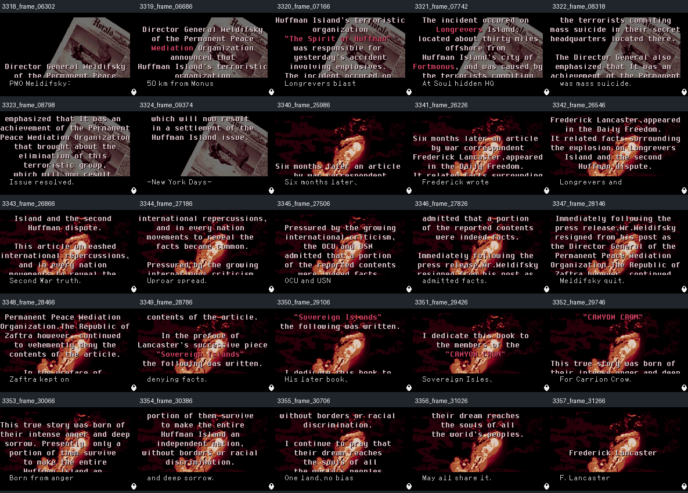

# Validación del epílogo nativo — v0.35-TEST

**Resultado: PASS para la lectura y presentación de los 25 registros solicitados
dentro del controlador nativo del epílogo.** La prueba no modificó la ROM ni la
redacción existente.

| Comprobación | Resultado |
| --- | --- |
| Registros 3318–3324 | 7/7 leídos y capturados |
| Registros 3340–3357 | 18/18 leídos y capturados |
| Subtítulos completos en las capturas | 25/25, sin recorte observado |
| Glifos japoneses / desconocidos | 0 / 0 |
| Terminadores y copias secundarias | 25/25 válidos; ambos `FFFF` intactos |
| Lecturas de las raíces 3317 / 3339 | 0 / 0 |
| Llegada natural mediante toda la campaña | No demostrada |

## Consumidor nativo identificado

El epílogo usa una tabla de 39 índices en `0x7EC6A8`. La instrucción
`E000:F9C5` obtiene el índice; el código de `6000:CE20` consulta la tabla
principal en `0x7427C0` y llama al renderizador secundario. Los 39 índices son
3318–3338 y 3340–3357: incluyen los 25 registros solicitados y 14 diálogos
intermedios, 3325–3338.

Los arreglos de punteros cercanos en `0x7CC124` y `0x7CC58C`, reparados por
v0.35, no fueron leídos durante esta secuencia. Su estructura es válida, pero la
prueba no demuestra otro consumidor. No se clasifican como datos sin uso.

## Método

Clasificación: **`SYNTHETIC_STATE`**. Mesen arranca la ROM y ejecuta una ruta de
entradas reproducible. En el frame 4200, el script escribe el evento `0x58` en el
registro vigente de evento de WRAM y desactiva el actualizador residual de la
batalla anterior mediante el bit 0 de WRAM `0x0900`. La rutina nativa inicializa
y avanza la escena durante 36.000 frames.

El script no sustituye punteros de texto, no cambia bytes de ROM, no adelanta
temporizadores ni contadores de página y no introduce botones tras la activación.
Las intervenciones están registradas en
`qa/epilogue_native/isolated_v035/trace.tsv`.

Se utilizó Mesen 2.1.1 mediante `mesen_visualization_source_v1.1.0`. La evidencia
compacta conserva:

- `qa/epilogue_native/native_validation.json`: auditoría de los 25 registros.
- `qa/epilogue_native/native_25_records.png`: lámina de las 25 capturas.
- `qa/epilogue_native/isolated_v035/`: 39 selecciones nativas, trazas, informe y
  capturas individuales.
- `tools/validate_isolated_epilogue.lua`: ruta y sondas Mesen.
- `tools/validate_native_evidence.py`: verificación sin ROM de la evidencia.



## Límites

Las frases inglesas breves son traducciones preexistentes y funcionan como
resúmenes. Esta revisión no aprueba su fidelidad lingüística. Los 14 diálogos
intermedios fueron seleccionados, pero una captura fija por selección no certifica
todas sus páginas.

Tampoco se aprueba la pantalla posterior a la firma ni los créditos completos.
En intentos sin aislar la batalla aparecieron bandas verdes tanto en la ROM
japonesa como en la inglesa; al desactivar el actualizador desaparecieron, pero
el cuadro final quedó prácticamente negro. No se parcheó la ROM para ocultar ese
efecto del acceso sintético.

## Reproducción

Con una ROM v0.35 cuyo SHA-256 sea
`bed365a706e13338c8bebc17723fc40f3804a114520524d3ad62f180d44f42c0`:

```sh
python3 tools/validate_native_evidence.py
python3 tools/run_native.py \
  --mesen /ruta/a/Mesen \
  --rom Front_Mission_v035_TEST.wsc \
  --out qa/repeticion_epilogo
```

El directorio de salida debe estar vacío. En Windows, `run_native.py` invoca
Mesen directamente; en sistemas Unix utiliza el envoltorio incluido en `vendor/`.
